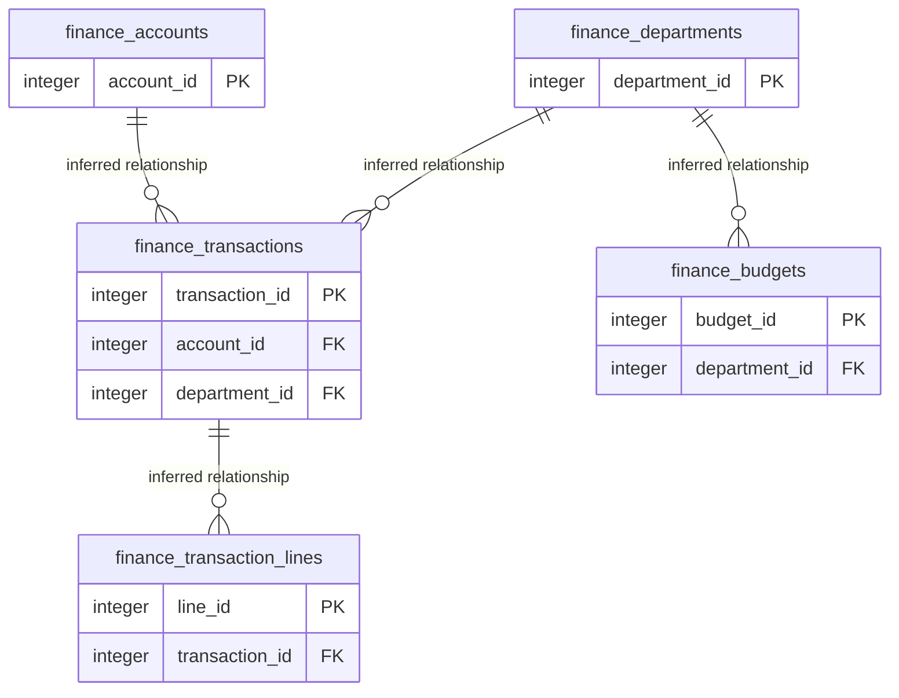

# Finance Database - Reverse Engineered ERD

## Relationship Evidence

The DuckDB metadata catalogue captured four FOREIGN KEY constraints.
However, the referenced table and referenced column fields were not
available in the extracted constraint metadata.

The four relationship endpoints below were reconstructed from the
source schema and validated against the source data. They are therefore
labelled as inferred/reconstructed rather than directly reverse-engineered
from the captured relationship metadata.

## Evidence

- Source system: SRC_FINANCE
- Database engine: DuckDB
- Schema: main
- Tables: 5
- Columns: 18
- Primary keys: 5
- Foreign key constraints captured: 4
- NOT NULL constraints: 17
- Foreign-key constraint types were captured from the source catalogue.
- Referenced table and column endpoints were unavailable in the captured metadata.
- Relationship endpoints shown in this ERD are inferred/reconstructed
  from the source schema and validated against the source data.

## Reverse Engineering Limitation

The draft ERD and DDL represent the five source tables and their
identified primary and foreign key structures. The extracted metadata
does not independently establish the referenced endpoints of the
DuckDB foreign keys. These endpoints are documented as inferred.
Other DBMS-specific features such as indexes, triggers, defaults,
and additional database-specific definitions may not be fully preserved.