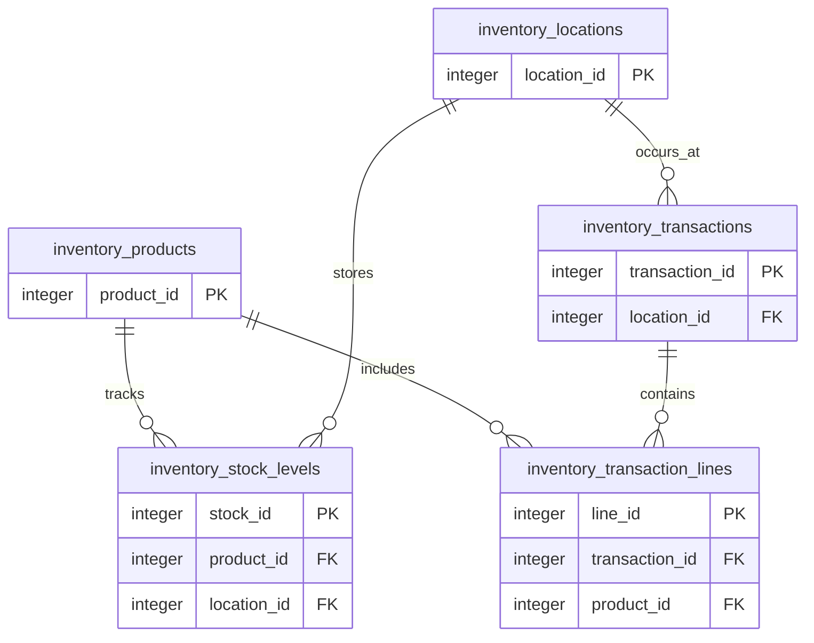

# Inventory Database - Reverse Engineered ERD

## Evidence
- Source system: SRC_INVENTORY
- Database engine: SQLite
- Schema: main
- Tables: 5
- Columns: 22
- Primary keys: 5
- Foreign keys: 5
- Relationships shown are declared source constraints.