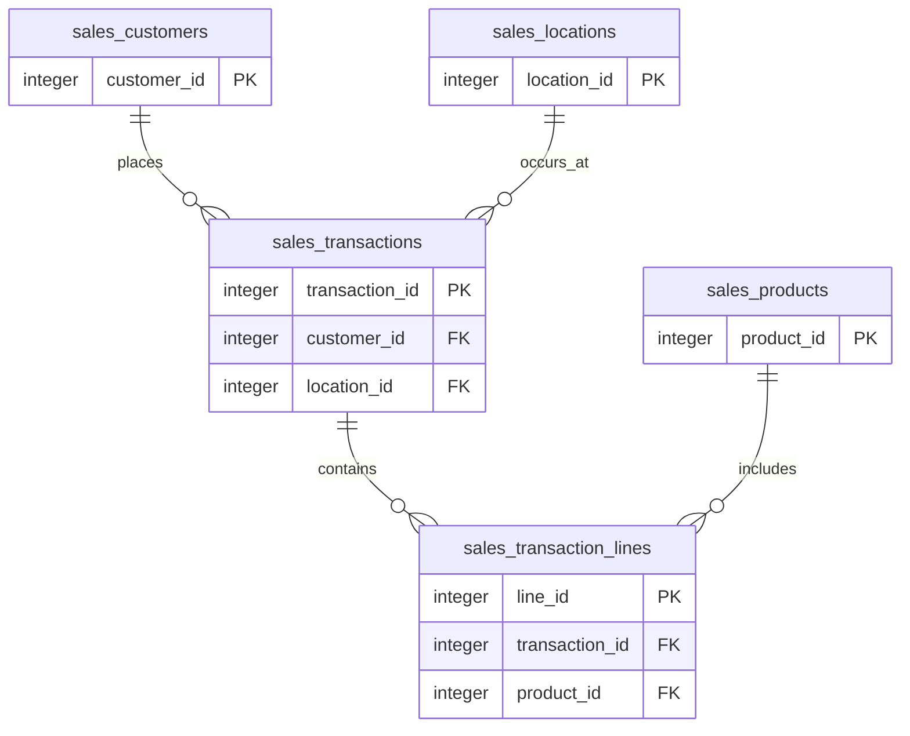

# Sales Database - Reverse Engineered ERD

## Evidence
- Source system: SRC_SALES
- Database engine: PostgreSQL
- Schema: public
- Tables: 5
- Columns: 23
- Primary keys: 5
- Foreign keys: 4
- Relationships shown are declared source constraints.